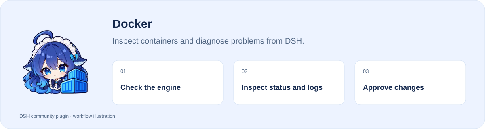

[简体中文](README.md) · **English**

# Docker

> **Inspect containers and logs read-only from DeepSeek Harness, then approve state changes explicitly.**

Docker management plugin for DeepSeek Harness (`>=0.2.2-rc.3`) with container/image health checks, log diagnosis, approval-gated `exec` & lifecycle actions, and clean Cordis hot-reload teardown.

[](https://www.npmjs.com/package/@stardustlc/dsh-docker) [](https://www.npmjs.com/package/@stardustlc/dsh-docker) [](https://www.npmjs.com/package/@stardustlc/dsh-docker)

**[Features](#features) · [Install](#install) · [Workflow](#start-using-it) · [Full guide](https://github.com/STARDUSTLC666/dsh-docker/blob/master/docs/REFERENCE.en.md)**

<picture>
  <source media="(prefers-color-scheme: dark) and (max-width: 640px)" srcset="https://raw.githubusercontent.com/STARDUSTLC666/dsh-docker/master/docs/assets/intro/workflow-en-mobile-dark.svg">
  <source media="(max-width: 640px)" srcset="https://raw.githubusercontent.com/STARDUSTLC666/dsh-docker/master/docs/assets/intro/workflow-en-mobile-light.svg">
  <source media="(prefers-color-scheme: dark)" srcset="https://raw.githubusercontent.com/STARDUSTLC666/dsh-docker/master/docs/assets/intro/workflow-en-dark.svg">
  
</picture>

## Features

| Capability | Details |
| :--- | :--- |
| **Read-Only Inspection** | Check running/exited containers, images, port mappings, env config, and daemon health without touching services |
| **Log Diagnosis** | Pull recent logs from failing containers and correlate errors directly with your workspace codebase |
| **Approval-Gated Actions** | Bounded in-container `exec` and start/stop/restart/cleanup operations pause for explicit host confirmation |

## Install

Open **Plugins** in the DSH desktop app and install `@stardustlc/dsh-docker`, or use the CLI:

```bash
dsh plugin --profile desktop add @stardustlc/dsh-docker
```

For the web profile, replace `desktop` with `web` and restart DSH. Requires DSH `>=0.2.2-rc.3`.

## Start using it

1. **Ensure Docker is running**: Start Docker Desktop or Docker Engine; status and log reads run strictly read-only.
2. **Diagnose failures**: Ask the assistant to list unhealthy or exited containers and analyze recent log lines against your repo.
3. **Approve changes explicitly**: Review container names in host approval cards before running `exec`, restart, stop, or remove actions.

### Ready-to-copy prompts

- **Read-only diagnosis**: `Check which containers are running or exited, pull the last 100 log lines of any failing service, and explain the root cause without restarting anything.`
- **Local stack check**: `Inspect the port mappings and health status of our local Postgres and Redis containers against .env.example.`
- **Restart & verify**: `Restart the api-server container after my confirmation, then check its startup logs to confirm it came up cleanly.`

## Before you start

- Requires a running Docker Engine accessible to the current user; write actions follow host approval policy.
- Full configuration, tools, and troubleshooting: [full reference](https://github.com/STARDUSTLC666/dsh-docker/blob/master/docs/REFERENCE.en.md).

## Plugin updates

Check updates at the bottom of native plugin details. Automatic checks are on by default; **automatic installation is off**. Suite-managed components update with their bundle.

## Documentation & feedback

- [Full usage, configuration and limits](https://github.com/STARDUSTLC666/dsh-docker/blob/master/docs/REFERENCE.en.md) · [Release notes](https://github.com/STARDUSTLC666/dsh-docker/blob/master/CHANGELOG.md) · [Validation history](https://github.com/STARDUSTLC666/dsh-docker/blob/master/docs/VALIDATION.md)
- Stars, [Issues](https://github.com/STARDUSTLC666/dsh-docker/issues), and [PRs](https://github.com/STARDUSTLC666/dsh-docker/pulls) are welcome (strip credentials first).

## License

[MIT](https://github.com/STARDUSTLC666/dsh-docker/blob/master/LICENSE)

<a id="what-it-does"></a>
<a id="requirements-and-configuration"></a>
