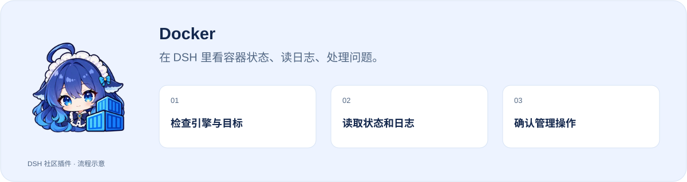

**简体中文** · [English](README.en.md)

# Docker

**在 DSH 里看容器状态、读日志、处理问题。**

DeepSeek Harness（`>=0.2.2-rc.3`）Docker 管理插件：提供容器与镜像状态巡检、日志查询、容器内受控命令执行及生命周期管理，写操作接入宿主审批策略并支持 Cordis 热重载清理。

[](https://www.npmjs.com/package/@stardustlc/dsh-docker) [](https://www.npmjs.com/package/@stardustlc/dsh-docker) [](https://www.npmjs.com/package/@stardustlc/dsh-docker)

**[安装使用](#安装) · [使用流程](#开始使用) · [完整说明](https://github.com/STARDUSTLC666/dsh-docker/blob/master/docs/REFERENCE.zh.md)**

<picture>
  <source media="(prefers-color-scheme: dark) and (max-width: 640px)" srcset="https://raw.githubusercontent.com/STARDUSTLC666/dsh-docker/master/docs/assets/intro/workflow-zh-mobile-dark.svg">
  <source media="(max-width: 640px)" srcset="https://raw.githubusercontent.com/STARDUSTLC666/dsh-docker/master/docs/assets/intro/workflow-zh-mobile-light.svg">
  <source media="(prefers-color-scheme: dark)" srcset="https://raw.githubusercontent.com/STARDUSTLC666/dsh-docker/master/docs/assets/intro/workflow-zh-dark.svg">
  
</picture>

## 功能

- 查看容器、镜像和资源状态。
- 围绕具体目标读取日志或运行受控命令。
- 核对启动、停止和清理操作的影响。

## 安装

在 DSH 桌面版「插件」面板安装 `@stardustlc/dsh-docker`。已配置命令行时也可使用：

```bash
dsh plugin --profile desktop add @stardustlc/dsh-docker
```

网页版把 `desktop` 改为 `web`；安装后重启对应的 DSH。宿主要求以包声明 `>=0.2.2-rc.3` 为准。

## 开始使用

不用反复切终端敲 `docker ps / logs / inspect`，按「先只读排查、再审批操作」三步用起来：

1. **确认本地 Docker 已启动**：先打开 Docker Desktop 或守护进程；直接在对话里问容器运行状态，只读巡检与看日志完全零破坏。
2. **定位异常容器与报错根因**：让助手列出异常退出的容器、拉取最近报错日志并结合当前项目代码排查原因。
3. **受控执行与生命周期确认**：需要在容器内跑诊断命令，或执行重启 / 停止 / 删除容器时，宿主会弹出明确的操作确认，核对容器名无误后再放行并复查状态。

常用场景怎么对助手说（可直接复制）：

- **日常只读排障**：`看看现在有哪些容器在跑或刚挂掉，把报错容器最近 100 行日志拉出来分析原因，先别重启。`
- **联调环境核对**：`检查本地数据库和缓存容器的端口映射、环境变量配置与健康状态是否和项目配置一致。`
- **确认后重启验证**：`重启 api-server 容器（执行前让我确认），启动后再看一眼最新日志确认没有报错。`

## 开始前要知道

需要已运行且当前用户可访问的 Docker Engine；操作遵循宿主审批。

配置、完整工具与排错见[详细使用说明](https://github.com/STARDUSTLC666/dsh-docker/blob/master/docs/REFERENCE.zh.md)。

## 插件更新

在工作台或原生插件详情页底部检查更新。默认自动检查，**默认不自动安装**；是否安装、何时重启由你决定。Suite 管理的组件随整包更新。[查看更新规则](https://github.com/STARDUSTLC666/dsh-docker/blob/master/docs/REFERENCE.zh.md)。

## 文档

- [详细使用、配置与边界](https://github.com/STARDUSTLC666/dsh-docker/blob/master/docs/REFERENCE.zh.md)
- [更新记录](https://github.com/STARDUSTLC666/dsh-docker/blob/master/CHANGELOG.md)
- [验证范围与历史](https://github.com/STARDUSTLC666/dsh-docker/blob/master/docs/VALIDATION.md)

## 反馈与贡献

如果插件帮到了你，欢迎 Star，让更多人发现它。问题和建议请提交 [Issues](https://github.com/STARDUSTLC666/dsh-docker/issues)，也欢迎代码与文档 [PR](https://github.com/STARDUSTLC666/dsh-docker/pulls)。反馈时附上版本与复现步骤，并移除凭据。

## License

[MIT](https://github.com/STARDUSTLC666/dsh-docker/blob/master/LICENSE)

<a id="依赖与配置"></a>
